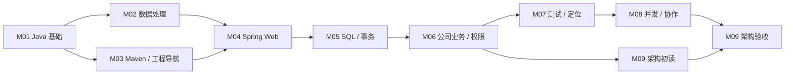

# Java 与公司项目路线 · 定稿

- 定稿：2026-10-23；用户确认 9 模块及交叉评估后的 5 项修订。
- 起点：能读部分 Java，尚未独立开发接口。
- 出口：独立接口、既有代码维护、两项目主要链路与修改影响判断。
- 资料与版本：[RESOURCES.md](RESOURCES.md)；公司事实：[PROJECT-STACK.md](PROJECT-STACK.md)。

## 前置关系

M02 与 M03 可交叉；M01 先使用最小工程，M03 再独立重建和解释配置。M04 先完成接口，再补与当前注解有关的反射、代理与装配机制。M09 初读只定位职责和产物，异步、资源与失败语义在相应前置能力具备后验收。

## 模块与出口

| 模块 | 核心任务 | 本轮规定范围的验收 |
|---|---|---|
| [M01](modules/01-java-basics/README.md) | 类型、对象、接口、异常起步与运行 | 自己写类和接口；解释空值、比较、重载/重写；运行与新输入验证 |
| [M02](modules/02-java-data/README.md) | 集合、泛型、异常、数据处理 | 销售数据与已知期望一致；解释集合选择、精度、空值和失败处理 |
| [M03](modules/03-maven-projects/README.md) | Maven、多模块和启动入口 | 从空目录重建小工程；区分构建依赖、运行调用、配置入口和未知版本 |
| [M04](modules/04-spring-web/README.md) | HTTP、DTO、IoC、校验、异常、装配 | 独立内存接口及失败场景；两项 JSON 契约；说明 Bean 的创建与依赖 |
| [M05](modules/05-persistence/README.md) | SQL → JDBC → MyBatis → Spring 事务 | 实际数据库上的查询/约束/回滚；参数绑定；解释公司连接状态恢复 |
| [M06](modules/06-company-business/README.md) | UDC 创建、CDP 前台运行与权限 | 自行找到关键调用；区分内容状态短路与数据行权限空结果；隔离权限练习 |
| [M07](modules/07-testing-debugging/README.md) | 分层测试与故障定位 | 只给现象的既有代码任务：复现、定位、最小修改、回归 |
| [M08](modules/08-concurrency-integration/README.md) | 并发、缓存、服务边界 | 本地验证上限、超时、中断、隔离、释放；解释公司远程调用边界 |
| [M09](modules/09-company-architecture/README.md) | 生成发布与查询架构 | 两张有源码依据的图、权限场景对照和一个小需求影响分析 |

两组贯穿材料是 [应用字典](practice/DICTIONARY.md) 与 [销售统计](practice/SALES.md)。升级现有练习，不增加第三个练习工程或额外毕业项目。

## 通过规则：能力、范围和证据

每个模块文件中的方框是需要验证的能力，不是课程准备待办。学习者完成后逐项链接实际证据，助手准备材料不勾选。

| 维度 | 有效证据 | 尚未具备时 |
|---|---|---|
| 独立练习 | 本人实现/修改、实际运行、关键失败用例、新变式 | 保持未验证或部分通过 |
| 公司源码理解 | 本人独立定位并解释，附路径、符号、提交和边界 | 可见部分按范围验收，外部实现单列 |
| 公司环境运行 | 对应环境的构建、测试、日志/断点或接口结果 | 明确待验证；不自动阻塞无此依赖的课程 |

**模块通过只覆盖其预先声明的本地练习和可见源码目标。** 公司运行或不可见实现不会被“通过”覆盖；M09 通过也不等于掌握全部运行侧实现。某项确实依赖缺失材料时，该项保持待验证，其他能力可继续推进。

独立工程练习可以查官方文档。接受关键提示或完整解法后，原题记“提示后完成”，换未见过的输入、边界或小需求独立复验。概念解释检验理解，不要求背 API。诊断只减免已验证的能力点，语法题正确不能免除独立接口任务。

## 深度与任务粒度

- **独立实现**：语言和数据处理、接口、SQL/事务、测试与局部并发实验。
- **源码解释**：公司装配、框架用法、池化连接恢复、RPC 边界、生成发布、查询执行与集成选择。
- **任务触发后深入**：基础框架内部、完整运行侧、查询规划/内存算法、具体中间件真实部署。

一个能力点的完整闭环可跨会话完成，每次只给“位置 / 本次小任务 / 完成标志”。后续模块列任务与验收边界，到学习时才细化当前小节；不预先生成全套考卷或替用户写业务答案。

## 三个能力检查点

1. M01–M05：从明确的接口契约实现到数据库结果；解释正常、非法输入和业务失败。
2. M06–M08：沿公司可见链路定位职责，并在既有小工程中独立定位、修改和验证同类问题。
3. M09：解释两个项目的关键职责与连接关系，对一个需求指出修改点、权限/事务影响和回归范围。

所有检查点以真实表现验收。课程定稿、代码准备、助手测试、资料笔记和源码调研都不产生学习成绩。
