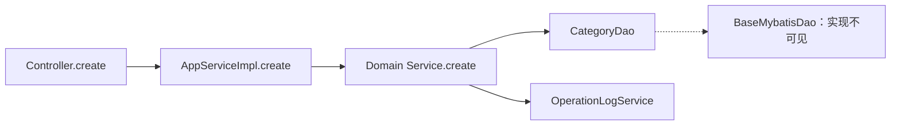
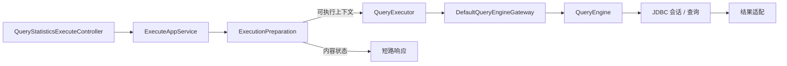

# 公司源码地图与课程证据

核对日期：2026-10-23。目录 `/Users/yu/Desktop/work/seeyon-backends`。下表为本轮只读核对的本地 `test` 快照，各工作区无改动；本轮没有 fetch，因此不把本地快照表述为实时远端最新状态。公司工程未构建、启动或执行测试。

## 仓库与用途

| 仓库 | test 提交 | 课程用途 |
|---|---|---|
| udc | a182384764a0d50c196dd8ff5ae36411b7ba59a7 | 业务分层、设计元数据、生成与发布调用侧 |
| cdp-report | 9f7622a5bf651cd7a9fe938f7583c1852ac455df | 数据集、报表查询、引擎、JDBC 与集成 |
| udc-parent | 15cd06318c8140c7f07821fb07964ff871ce4bfd | 依赖继承与版本边界 |
| udc-facade | a0ae631845362a55b7a100f03dc8ed219dd001c1 | 公共接口与 DTO 样例 |
| udc-common | d10b1bc077abd17ec23dc813d1f932380d368b2e | 公共模型与支持代码 |
| udc-plugin-api | 4cb87286badec0eb1d38557b7b8ecc311e17bf2e | 泛型接口、插件注册与异步执行 |
| boot-extend | 75a13a3771a7bd611b0826fa3a7fed22545a5756 | 基础能力扩展；不是 boot 基础实现的替代 |

UDC 的 6 个模块：biz、web、test、assemble、cicd、upgrade。CDP Report 的 10 个模块：core、integration、datasource、dataset、query、report、biz、web、test、assemble。报表 test 是完整业务实现，旧 master 的骨架结论不再适用。

UDC 继承 udc-parent，udc-parent 与 CDP Report、boot-extend 继承 `com.seeyon:boot:6.0.0-TEST-SNAPSHOT`。这是公司依赖版本，不能解释成 Spring Boot 6。公司 JDK、Spring、MyBatis 具体版本及部署环境仍待补证据。

## 导航与装配（M03–M04）

先读 [UDC AGENTS](/Users/yu/Desktop/work/seeyon-backends/udc/AGENTS.md) 与 [CONTEXT-MAP](/Users/yu/Desktop/work/seeyon-backends/udc/CONTEXT-MAP.md)。构建依赖图与运行调用图分开说明；接口实际在哪个模块，以全仓符号检索为准。

- [UDC 启动类](/Users/yu/Desktop/work/seeyon-backends/udc/udc-assemble/src/main/java/com/seeyon/udc/UdcApplication.java:16)：BootApp、SeeyonInitializer 是可见入口，底层扫描/注册实现待 boot。
- [CDP QueryEngineConfiguration](/Users/yu/Desktop/work/seeyon-backends/cdp-report/cdp-report-query/src/main/java/com/seeyon/cdp/report/query/config/QueryEngineConfiguration.java:102)：解释一个明确的 Bean 创建点；内部直接 new 的对象不自动视为 Spring Bean。
- [插件接口](/Users/yu/Desktop/work/seeyon-backends/udc-plugin-api/src/main/java/com/seeyon/udc/plugin/PluginExecutor.java:16)、[插件执行基类](/Users/yu/Desktop/work/seeyon-backends/udc-plugin-api/src/main/java/com/seeyon/udc/plugin/AbstractPluginExecutor.java:28)：分别用于泛型契约、生命周期与异步边界。

## UDC 业务链路（M06）

| 位置 | 应解释的内容 |
|---|---|
| [Controller.create](/Users/yu/Desktop/work/seeyon-backends/udc/udc-web/src/main/java/com/seeyon/udc/controller/UdcEnumCategoryController.java:50) | HTTP、DTO、请求包装、服务接口 |
| [接口](/Users/yu/Desktop/work/seeyon-backends/udc/udc-biz/src/main/java/com/seeyon/udc/api/UdcEnumCategoryAppService.java:21) / [DTO](/Users/yu/Desktop/work/seeyon-backends/udc/udc-biz/src/main/java/com/seeyon/udc/dto/UdcEnumCategoryDto.java:19) | 二者都在 udc-biz，本地可见 |
| [AppService 实现](/Users/yu/Desktop/work/seeyon-backends/udc/udc-biz/src/main/java/com/seeyon/udc/appservice/UdcEnumCategoryAppServiceImpl.java:49) | 事务与权限声明；注解存在不证明实际拦截顺序 |
| [领域服务](/Users/yu/Desktop/work/seeyon-backends/udc/udc-biz/src/main/java/com/seeyon/udc/entity/domain/service/UdcEnumCategoryService.java:79) | 业务校验、转换、持久化与日志 |
| [DAO](/Users/yu/Desktop/work/seeyon-backends/udc/udc-biz/src/main/java/com/seeyon/udc/entity/domain/dao/UdcEnumCategoryDao.java:11) | 继承关系与基类边界；具体 SQL 尚待核实 |
| [UdcAppOpsFilter](/Users/yu/Desktop/work/seeyon-backends/udc/udc-biz/src/main/java/com/seeyon/udc/collaboration/filter/UdcAppOpsFilter.java:48) | 可见的注解/SpEL 权限处理；注册顺序与上下文形成仍需基础实现 |

## CDP 前台查询链路（M06）

- [Controller](/Users/yu/Desktop/work/seeyon-backends/cdp-report/cdp-report-web/src/main/java/com/seeyon/cdp/report/controller/querystatistics/QueryStatisticsExecuteController.java:57) → [AppService](/Users/yu/Desktop/work/seeyon-backends/cdp-report/cdp-report-report/src/main/java/com/seeyon/cdp/report/querystatistics/appservice/QueryStatisticsExecuteAppService.java:43)。
- [ExecutionPreparation.prepareSaved](/Users/yu/Desktop/work/seeyon-backends/cdp-report/cdp-report-report/src/main/java/com/seeyon/cdp/report/querystatistics/execute/QueryStatisticsExecutionPreparation.java:72)：资源使用权限、数据集可用性与使用授权。短路前可能已读取元数据，区分元数据访问与目标业务数据查询。
- [QueryExecutor](/Users/yu/Desktop/work/seeyon-backends/cdp-report/cdp-report-report/src/main/java/com/seeyon/cdp/report/querystatistics/execute/QueryStatisticsQueryExecutor.java:58) → [Gateway](/Users/yu/Desktop/work/seeyon-backends/cdp-report/cdp-report-report/src/main/java/com/seeyon/cdp/report/querystatistics/execute/gateway/DefaultQueryEngineGateway.java:35) → [QueryEngine](/Users/yu/Desktop/work/seeyon-backends/cdp-report/cdp-report-query/src/main/java/com/seeyon/cdp/report/query/QueryEngine.java:28)。第一轮追 detailQuery/statQuery；接口还有 querySql，不把主线两分支当成接口全部功能。
- [数据行权限分支](/Users/yu/Desktop/work/seeyon-backends/cdp-report/cdp-report-query/src/main/java/com/seeyon/cdp/report/query/DefaultQueryEngine.java:272)：可能返回保留结构的空结果。它与准备阶段内容状态短路是不同语义，不统一当作异常或假定都执行了目标 SQL。
- [JdbcQueryDatabaseExecutor](/Users/yu/Desktop/work/seeyon-backends/cdp-report/cdp-report-query/src/main/java/com/seeyon/cdp/report/query/execution/jdbc/JdbcQueryDatabaseExecutor.java:60)：连接、只读事务、会话、提交/回滚、状态恢复与归还。

## M09 增量阅读

| 路线 | 已有入口与本轮深度 |
|---|---|
| UDC 删除后续 | [领域删除事件](/Users/yu/Desktop/work/seeyon-backends/udc/udc-biz/src/main/java/com/seeyon/udc/entity/domain/service/UdcEnumCategoryService.java:161) → [枚举项处理监听器](/Users/yu/Desktop/work/seeyon-backends/udc/udc-biz/src/main/java/com/seeyon/udc/domain/listener/UdcEnumCategoryEventListener.java:31)；发送/处理可见，事件同步性和回滚保证待证实 |
| 设计到生成 | [AutoCodeExecutor](/Users/yu/Desktop/work/seeyon-backends/udc/udc-biz/src/main/java/com/seeyon/udc/autocode/AutoCodeExecutor.java:63) → [EntityTask](/Users/yu/Desktop/work/seeyon-backends/udc/udc-biz/src/main/java/com/seeyon/udc/autocode/task/EntityTask.java:25)；解释上下文、schema、任务与产物 |
| 发布调用侧 | [DeploymentService](/Users/yu/Desktop/work/seeyon-backends/udc/udc-biz/src/main/java/com/seeyon/udc/deployment/DeploymentService.java:216) → [PipeLineManager](/Users/yu/Desktop/work/seeyon-backends/udc/udc-cicd/src/main/java/com/seeyon/udc/pipeline/PipeLineManager.java:522)；任选一种发布方式，说明调用、返回、任务与状态关系 |
| CDP 三场景 | [prepareSaved / prepareUnsaved](/Users/yu/Desktop/work/seeyon-backends/cdp-report/cdp-report-report/src/main/java/com/seeyon/cdp/report/querystatistics/execute/QueryStatisticsExecutionPreparation.java:72)；比较未保存设计预览、已保存后台预览、前台运行 |
| 并发资源 | [StatQueryBulkhead](/Users/yu/Desktop/work/seeyon-backends/cdp-report/cdp-report-query/src/main/java/com/seeyon/cdp/report/query/execution/runtime/StatQueryBulkhead.java:32)；读许可、超时、中断与释放 |
| 缓存与 RPC（M08） | [QueryResultCacheKeyFactory](/Users/yu/Desktop/work/seeyon-backends/cdp-report/cdp-report-query/src/main/java/com/seeyon/cdp/report/query/execution/cache/QueryResultCacheKeyFactory.java:15) 用于核对实际缓存键；[AppCollaborationAppServiceImpl](/Users/yu/Desktop/work/seeyon-backends/udc/udc-biz/src/main/java/com/seeyon/udc/appservice/AppCollaborationAppServiceImpl.java:37) 与 [AppDataPushService](/Users/yu/Desktop/work/seeyon-backends/udc/udc-biz/src/main/java/com/seeyon/udc/autocode/form/AppDataPushService.java:79) 分别是服务暴露与远程引用示例，不据此认定二者互相调用 |
| 可选集成 | [IntegrationAdapterResolver](/Users/yu/Desktop/work/seeyon-backends/cdp-report/cdp-report-integration/src/main/java/com/seeyon/cdp/report/integration/common/IntegrationAdapterResolver.java:46) 与 [对应测试](/Users/yu/Desktop/work/seeyon-backends/cdp-report/cdp-report-integration/src/test/java/com/seeyon/cdp/report/integration/common/IntegrationAdapterResolverTest.java:31)；解释无/唯一/多个候选时的行为 |
| 统计语义 | [QueryEngineDataGridTest](/Users/yu/Desktop/work/seeyon-backends/cdp-report/cdp-report-query/src/test/java/com/seeyon/cdp/report/query/QueryEngineDataGridTest.java:77)；选汇总与分页用例解释预期，未执行就仅记阅读 |

最终保留两张可增补的链路图，图中标源码确认、契约推断、实现不可见和运行待验。底层 boot、部分公共依赖及生成应用运行侧的缺口见 [SOURCE-REQUESTS.md](SOURCE-REQUESTS.md)。当前证据支持架构阅读与局部练习，不支持宣称已验证整个公司运行环境。
